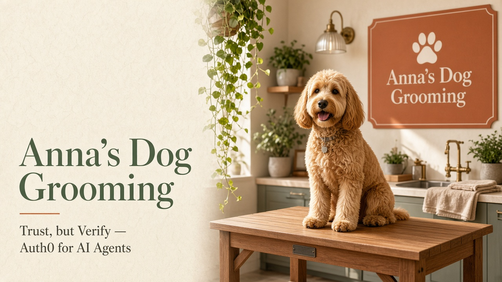
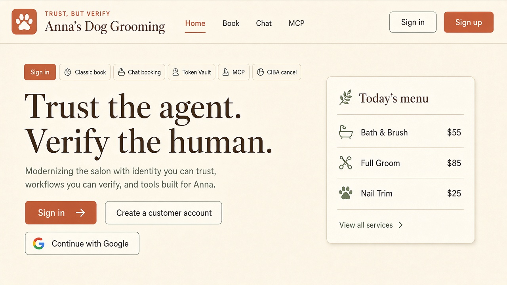
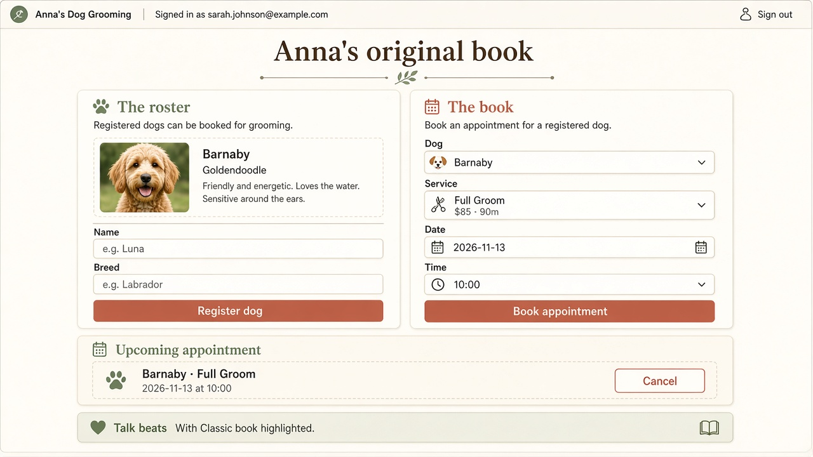
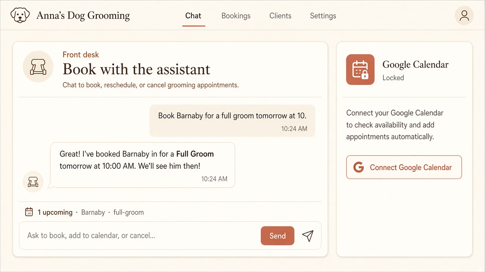
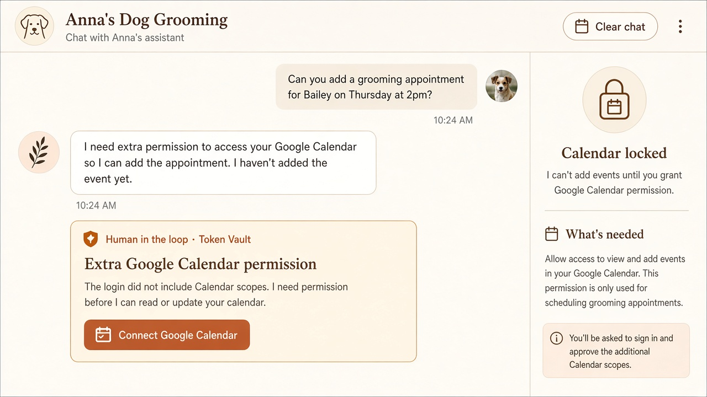
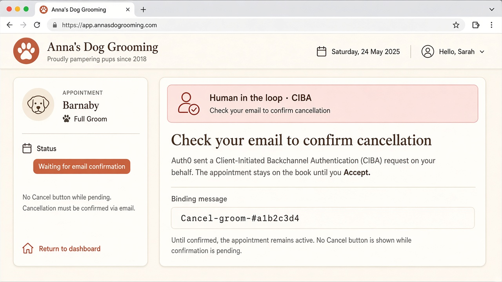

# Anna's Dog Grooming — Trust, but Verify

Stage demo for Focus Otter's 20-minute Auth0 talk: **trust the agent, verify the human**.

A boutique Next.js salon that walks the audience through six beats — classic login, a traditional booking form, a chatbot that books the same visits, Auth0 Token Vault before Google Calendar scopes expand, an in-app MCP server for Grok Bot, and **real Client-Initiated Backchannel Authentication** so a cancel is not deleted until the customer Accepts in email.



**Do not point this app at the workshop tenants.** Use the **demo-showcase** Auth0 tenant only. Never `dev-bxdvx0t63i1hlqdi` or `anna-grooming.us.auth0.com`. Never run the Auth0 CLI or Management API against those tenants.

Full tenant + Neon + Vercel checklist: **[SETUP.md](./SETUP.md)**.

---

## Talk arc (20 minutes)

| Beat | What you show | What the audience should notice |
| ---: | --- | --- |
| 1 | Sign in with Auth0 (email/password **and** Google) | Identity only. Calendar scopes are **not** on Universal Login. |
| 2 | Classic `/book` form | Dogs + Bath & Brush / Full Groom / Nail Trim. The “before.” |
| 3 | `/chat` books the same data conversationally | Same Neon rows, same customer `sub`. |
| 4 | “Add this to Google Calendar” | Agent **pauses**. Token Vault / Connected Accounts. No silent scope expansion. |
| 5 | Grok Bot → MCP `/mcp` | Auth0-authorized tools: list, book, cancel. The visit from beats 2–3 is visible. |
| 6 | `cancel_appointment` | Auth0 emails CIBA. Row stays until Accept. Not a chat “are you sure?” |

---

## Screenshots

### 1. Login



Email/password or **Continue with Google**. Login scopes are `openid profile email offline_access`.

### 2. Traditional booking form



Register a dog (Barnaby in one click for the live demo), then work through the visit request — service, two dates, a Pacific time slot, and day-of details. The “before.”

### 3. Chatbot booking



Same roster and appointments as the form, as a short back-and-forth in Pacific time. Try: *Book Barnaby tomorrow at 11:30.* One small question per turn — not a wall of text.

### 4. Token Vault permission pause



The assistant must ask. Click **Connect Google Calendar** → Auth0 `/auth/connect` requests Calendar scopes. This app never stores the Google refresh token.

### 5. Cancel + CIBA email



Cancel from the form, the chat, or MCP. Auth0 emails the signed-in user (`login_hint` `iss_sub`, `requested_expiry=301` so delivery is **email**, not Guardian push). The appointment is **not deleted** until they Accept.

---

## How to run the talk

1. Coordinator finishes [SETUP.md](./SETUP.md) (Auth0 demo-showcase app + API + CIBA + Token Vault + Neon + Vercel env).
2. Open the production URL. Confirm the header does **not** say “Setup needed”.
3. Sign in (email/password, then Google on a second pass if you want both on stage).
4. `/book` — add Barnaby, book Full Groom.
5. `/chat` — “Add that visit to my Google Calendar.” Pause on the Token Vault card, connect, then ask again.
6. `/connect` — copy the MCP URL into Grok Bot. `list_appointments`, optionally `book_appointment`, then `cancel_appointment`.
7. Show `/book`: status is waiting on email. Open the CIBA mail, Accept, wait ~2s. The visit disappears.

### MCP connection (Grok Bot / Inspector)

- Server URL (Streamable HTTP): `https://<your-domain>/mcp`
- Protected resource metadata: `https://<your-domain>/.well-known/oauth-protected-resource`
- Resource identifier / audience: `https://<your-domain>/mcp` (must match `AUTH0_AUDIENCE`)
- Sign in with Auth0 when the client prompts. Request the tool scopes below.

| Tool | Scope | Notes |
| --- | --- | --- |
| `list_appointments` | `tool:list_appointments` | Includes CIBA-pending rows |
| `book_appointment` | `tool:book_appointment` | Bath & Brush / Full Groom / Nail Trim |
| `cancel_appointment` | `tool:cancel_appointment` | Starts CIBA; `deleted: false` until Accept |
| `list_dogs` / `add_dog` | `tool:list_dogs` / `tool:add_dog` | Optional helpers |

### What the audience sees at each HITL step

- **Token Vault** — a card in the chat UI. Google consent screen for Calendar. Agent does not claim success until Token Vault returns a token and Calendar API writes.
- **CIBA** — email to the signed-in user, binding message `Cancel-groom-#<id>`. UI badge “Waiting for email confirmation”. MCP tool result stays `pending`. After Accept, poll deletes the row.

---

## Local development

```bash
cp .env.example .env.local
# fill values from SETUP.md — never commit .env.local
npm install
npm run dev
```

Open [http://localhost:3000](http://localhost:3000). If Auth0/Neon env is missing, the home page lists what is still empty.

Schema is applied on first query (`lib/db.ts`) and lives in [`db/schema.sql`](./db/schema.sql). Persistence is **Neon Postgres**, not SQLite.

---

## Env vars

| Name | Required | Purpose |
| --- | --- | --- |
| `AUTH0_SECRET` | yes | Session cookie encryption (`openssl rand -hex 32`) |
| `APP_BASE_URL` | yes | Public origin, no trailing slash |
| `AUTH0_DOMAIN` | yes | demo-showcase hostname only |
| `AUTH0_CLIENT_ID` | yes | Regular Web Application |
| `AUTH0_CLIENT_SECRET` | yes | Same app. Never commit. |
| `AUTH0_AUDIENCE` | for MCP | Resource identifier, usually `$APP_BASE_URL/mcp` |
| `MCP_SERVER_URL` | optional | Override if the resource URL differs |
| `DATABASE_URL` | yes | Neon **pooled** URL, `?sslmode=require` |
| `AI_GATEWAY_API_KEY` | for chat locally | Skip on Vercel if AI Gateway + OIDC is on |
| `AI_GATEWAY_MODEL` | optional | Default `anthropic/claude-sonnet-4.5` |

Placeholders only live in `.env.example`. Never commit or paste client secrets, Management API secrets, or database URLs.

---

## Stack

- Next.js 16 App Router + `proxy.ts` (`@auth0/nextjs-auth0` v4)
- Neon Postgres (`@neondatabase/serverless`)
- Vercel AI SDK + AI Gateway chatbot
- Auth0 Token Vault via Connected Accounts (`enableConnectAccountEndpoint`, `/auth/connect`, `getAccessTokenForConnection`)
- Real CIBA: `POST /bc-authorize` + `grant_type=urn:openid:params:grant-type:ciba`
- MCP Streamable HTTP at `/mcp` (`mcp-handler` + `@auth0/auth0-api-js` JWT verify)

Talk demo by [Michael Liendo](https://github.com/mtliendo) ([@focusotter](https://x.com/focusotter)), Staff Developer Advocate at Auth0.
